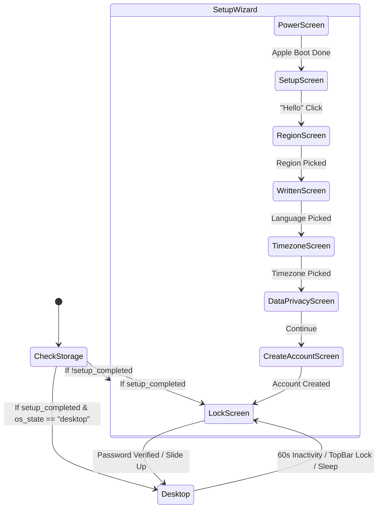

# macOS Web Simulator — The Complete Architectural & Implementation Manual (0.000001% to 101%)

> **Project Name:** macOS Web Simulator (os-portfolio)  
> **Production Live URL:** [https://zenithsuihub.vercel.app](https://zenithsuihub.vercel.app)  
> **Source Origin:** [LikhithSP/MacOS-Web-Simulator](https://github.com/LikhithSP/MacOS-Web-Simulator)  
> **Primary Technology Stack:** React 19, Vite 7, Tailwind CSS v4, Zustand v5, Framer Motion v12, GSAP v3, React Rnd v10, Lucide React, React Icons, WebGL 2.0 / GLSL Shaders.

---

## Table of Contents
1. [System Overview & Architectural Philosophy](#1-system-overview--architectural-philosophy)
2. [Complete Repository Directory Tree](#2-complete-repository-directory-tree)
3. [System Boot Sequence & State Machine](#3-system-boot-sequence--state-machine)
4. [Centralized Global State Engine (`Appstore.js`)](#4-centralized-global-state-engine-appstorejs)
5. [Windowing System & Desktop Canvas (`AppWindow.jsx` & `DesktopWindow.jsx`)](#5-windowing-system--desktop-canvas-appwindowjsx--desktopwindowjsx)
6. [macOS System Chrome: TopBar, Dock & Control Center](#6-macos-system-chrome-topbar-dock--control-center)
7. [Comprehensive Deep Dive: Every Native Application](#7-comprehensive-deep-dive-every-native-application)
   - [7.1 Finder (`Finder.jsx`)](#71-finder-finderjsx)
   - [7.2 Safari (`Safari.jsx`)](#72-safari-safarijsx)
   - [7.3 Spotify (`Spotify.jsx`)](#73-spotify-spotifyjsx)
   - [7.4 Messages (`Messages.jsx`)](#74-messages-messagesjsx)
   - [7.5 Mail (`Mail.jsx`)](#75-mail-mailjsx)
   - [7.6 FaceTime (`FaceTime.jsx`)](#76-facetime-facetimejsx)
   - [7.7 Phone (`Phone.jsx`)](#77-phone-phonejsx)
   - [7.8 Calendar (`Calendar.jsx`)](#78-calendar-calendarjsx)
   - [7.9 Reminders (`Reminders.jsx`)](#79-reminders-remindersjsx)
   - [7.10 Maps (`Maps.jsx`)](#710-maps-mapsjsx)
   - [7.11 Photos / Gallery (`Gallary.jsx`)](#711-photos--gallery-gallaryjsx)
   - [7.12 System Settings / About This Mac (`Settings.jsx`)](#712-system-settings--about-this-mac-settingsjsx)
   - [7.13 Notes & Developer Blog (`BlogsSection.jsx`)](#713-notes--developer-blog-blogssectionjsx)
   - [7.14 TextEdit (`TextEdit.jsx`)](#714-textedit-texteditjsx)
   - [7.15 PDF Viewer (`PDFViewer.jsx`)](#715-pdf-viewer-pdfviewerjsx)
   - [7.16 Trash Bin (`Trash.jsx`)](#716-trash-bin-trashjsx)
   - [7.17 Launchpad (`Launchpad.jsx`)](#717-launchpad-launchpadjsx)
8. [Liquid Glass & Optical WebGL Shader Engine](#8-liquid-glass--optical-webgl-shader-engine)
9. [Desktop & Lock Screen Widget Suite](#9-desktop--lock-screen-widget-suite)
10. [Constants, Audio Pipeline & Depth Wallpaper Engine](#10-constants-audio-pipeline--depth-wallpaper-engine)
11. [Styling Architecture & Design Tokens](#11-styling-architecture--design-tokens)
12. [Vercel Deployment, Bundling & Runtime Pipeline](#12-vercel-deployment-bundling--runtime-pipeline)
13. [End-to-End Event Communication Architecture](#13-end-to-end-event-communication-architecture)
14. [Troubleshooting, Gotchas & Debugging Playbook](#14-troubleshooting-gotchas--debugging-playbook)

---

## 1. System Overview & Architectural Philosophy

The **macOS Web Simulator** is a zero-latency, client-side operating system environment executed entirely inside the browser. It faithfully replicates the Apple macOS Human Interface Guidelines (HIG), encompassing macOS Sonoma, Sequoia, and Tahoe design languages.

### Core Architectural Axioms
1. **Zero Native C++ Dependencies**: The application executes strictly using Web Standards (HTML5, ES2023, CSS3, WebGL 2.0, Web Audio API, LocalStorage). It requires no SQLite bindings, node-gyp builds, or host-level binary compilation.
2. **Deterministic Single Page Execution**: Bundled with Vite 7 into highly optimized static ESM chunks, fully cacheable on edge CDNs (Vercel Edge Network), with route rewrites pointing to `index.html`.
3. **Decoupled Window Virtualization**: Applications run inside sandboxed window wrappers (`AppWindow.jsx`) managed by `react-rnd`, featuring independent z-index hierarchies, drag-bounds confinement, traffic light window controls, and minimized/maximized state transitions.
4. **Physical Optical Simulation**: Rather than relying purely on CSS `backdrop-filter: blur()`, the simulator features custom WebGL fragment shaders that calculate dome refraction, lens distortion, chromatic aberration, and specular edge highlights to produce authentic Apple Liquid Glass.
5. **Real Hardware Interactivity**:
   - Web Audio API and HTML5 `<audio>` for background and system soundscapes.
   - WebRTC `navigator.mediaDevices.getUserMedia` for live FaceTime video streaming.
   - Dual-mode pointer tracking for Dock magnification curves and marquee selection boxes.

---

## 2. Complete Repository Directory Tree

Below is the verified layout of every tracked file and directory within the project root:

```
hub/
├── .env                              # Environment variable definition (client-safe)
├── .env.example                      # Template for public/private keys
├── .gitignore                        # Git exclusion rules (node_modules, dist, research)
├── components.json                   # Shadcn/ui component scaffolding definition
├── eslint.config.js                  # Flat ESLint configuration rules
├── index.html                        # Root HTML5 DOM entry point
├── jsconfig.json                     # Path alias definitions (@/* -> ./src/*)
├── LICENSE                           # MIT Open Source License
├── package.json                      # Dependencies and npm script definitions
├── package-lock.json                 # Pinned package lockfile
├── postcss.config.js                 # Empty PostCSS config (avoids Tailwind v3 parent conflict)
├── README.md                         # Standard project documentation
├── tailwind.config.js                # Tailwind CSS v4 layout and animation extensions
├── vercel.json                       # Vercel deployment and SPA rewrite rules
├── vite.config.js                    # Vite 7 build configuration with ESM path resolving
├── preview/                          # Repository documentation screenshots
│   ├── prev.png
│   ├── preview.png
│   ├── preview0.png
│   └── preview1.png
├── public/                           # Uncompiled static assets served at domain root
│   ├── vite.svg
│   ├── icons/                        # Apple system & avatar icons
│   │   ├── apple.png                 # Monochromatic Apple logo
│   │   ├── chicken.png               # Avatar options
│   │   ├── cow-face.png
│   │   ├── fox.png
│   │   ├── hello.png
│   │   ├── Hello16MacBookProBlk.png
│   │   ├── lockscreen.gif            # Dynamic lockscreen avatar animation
│   │   ├── macos-sequoia.jpg         # Sequoia System Settings logo
│   │   ├── owl.png
│   │   ├── panda.png
│   │   ├── PngItem_*.png             # System badges and icons
│   │   └── trash.png                 # Empty/Full trash state icons
│   ├── images/                       # Boot & hardware illustrations
│   │   ├── lockscreen.jpg
│   │   ├── macos27.png
│   │   └── power up.png
│   └── Wallpaper/                    # Ultra-HD 6K macOS dynamic stock wallpapers
│       ├── 11-0-Big-Sur-Day-6k.jpg
│       ├── 1175801.jpg
│       ├── 13-Ventura-Light.jpg
│       ├── 15-inch-MacBook-Air-wallpaper-1.webp
│       ├── 26-Tahoe-Beach-Dawn-thumb.jpeg
│       ├── 26-Tahoe-Light-6K-thumb.jpeg
│       ├── 451898.jpg
│       ├── big-sur-mountains-night-dark-macos-big-sur-stock-california-6016x6016-1493.jpg
│       ├── chris-brignola-n7n-nkadHRM-unsplash.jpg
│       ├── FGrad_Feb21_Mac.png
│       ├── five.png
│       ├── formula-1-formula-cars-ferrari-ferrari-f1-ferrari-formula-1-hd-wallpaper-79f662068bca0f4ad0cb02dae8b765b3.jpg
│       ├── golden-gate-bridge-san-francicso-lg.jpg
│       ├── Golden_Dark_6k.png
│       ├── GoldenGate_6k.png
│       ├── GtB-Ex7WYAA9yAD.jpeg
│       ├── HJv1q-1bAAAxn-W.jpg
│       ├── HKT-kq1W8AA8dat.jpg
│       ├── HKfYptPbkAArZ5W.jpg
│       ├── macOS-Catalina-Dark-Mode.jpg
│       ├── macOS-Sonoma-light.jpg
│       ├── macOS-Sonomaa-dark.jpg
│       ├── macos-big-sur-stock-night-lone-tree-sedimentary-rocks-6016x6016-3776.jpg
│       └── three.jpg
└── src/                              # Application source code
    ├── App.jsx                       # Root Lifecycle Controller & State Switcher
    ├── index.css                     # Global styles, fonts, scrollbars, Tailwind v4
    ├── main.jsx                      # React 19 DOM entry mount
    ├── app/                          # Native macOS application implementations
    │   ├── Calendar.jsx              # Apple Calendar (Month/Week/Day/Year + Events)
    │   ├── Contacts.jsx              # Address Book & VCard inspector
    │   ├── FaceTime.jsx              # WebRTC video caller with live webcam stream
    │   ├── Finder.jsx                # Multi-view file manager (Icons/List/Cols/Gallery)
    │   ├── Folder.jsx                # Generic desktop folder directory inspector
    │   ├── Gallary.jsx               # Photos app with lightbox and metadata view
    │   ├── Launchpad.jsx             # Fullscreen application launcher grid
    │   ├── Mail.jsx                  # 3-pane email client with composer
    │   ├── Maps.jsx                  # Map canvas, coordinates search, satellite toggle
    │   ├── Messages.jsx              # iMessage chat client with pinned contacts
    │   ├── PDFViewer.jsx             # PDF document viewer with zoom & controls
    │   ├── Phone.jsx                 # Phone dial pad with DTMF tone simulation
    │   ├── Reminders.jsx             # Task manager with smart lists & subtasks
    │   ├── Safari.jsx                # Tabbed web browser with iframe sandbox
    │   ├── Settings.jsx              # System Settings / About This Mac inspector
    │   ├── Spotify.jsx               # Music player with real HTML5 audio engine
    │   ├── TextEdit.jsx              # Rich text editor with formatting toolbar
    │   ├── Trash.jsx                 # Trash bin with file restore and cleanup
    │   └── Blogs/
    │       └── BlogsSection.jsx      # Apple Notes / Developer Blog system
    ├── assets/                       # Bundled static media & audio MP3s
    │   ├── Ariana Grande - we can't be friends (wait for your love).mp3
    │   ├── Billie Eilish - BLUE.mp3
    │   ├── Charlie Puth - How Long.mp3
    │   ├── Chemtrails Over The Country Club.mp3
    │   ├── Dua Lipa - Love Again.mp3
    │   ├── Haareya Meri Pyaari Bindu 128 Kbps.mp3
    │   ├── Justin Bieber - Love Yourself.mp3
    │   ├── Michael Jackson - Billie Jean.mp3
    │   ├── react.svg
    │   └── The Weeknd - Is There Someone Else.mp3
    ├── components/                   # System UI components & Chrome
    │   ├── AppWindow.jsx             # Draggable/resizable window frame with traffic lights
    │   ├── ContextMenu.jsx           # Right-click contextual menus with submenus
    │   ├── ControlCenter.jsx         # macOS Control Center with interactive sliders
    │   ├── Dock.jsx                  # Magnified animated application launcher dock
    │   ├── ProjectCard.jsx           # Developer portfolio project card
    │   ├── song.jsx                  # Floating audio mini-player
    │   ├── TopBar.jsx                # 30px frosted Apple top menu bar
    │   ├── lib/
    │   │   └── utils.js              # Classnames merger helper (`clsx` + `twMerge`)
    │   ├── ui/                       # Reusable UI primitives & Glass Shader Engine
    │   │   ├── button.jsx            # CVA button primitives
    │   │   ├── calendar.jsx          # Day picker calendar component
    │   │   ├── dropdown-menu.jsx     # Radix UI dropdown primitive
    │   │   ├── glass-motion.js       # Dynamic physics for glass surface spring motions
    │   │   ├── glass-surface.jsx     # High-level wrapper for frosted glass elements
    │   │   ├── glass-webgl.jsx       # Low-level WebGL 2.0 shader engine
    │   │   └── glass.jsx             # Core glass refraction & dispersion mathematics
    │   └── widgets/                  # Desktop & Lock Screen widgets
    │       ├── CalendarWidget.jsx
    │       ├── ClockWidget.jsx
    │       ├── GlassCalendarWidget.jsx
    │       ├── GlassClockWidget.jsx
    │       ├── GlassDayWidget.jsx
    │       ├── GlassMiniCalendarWidget.jsx
    │       ├── GlassRemindersWidget.jsx
    │       ├── GlassSFWeatherWidget.jsx
    │       ├── GlassSmallWorldClockWidget.jsx
    │       ├── GlassWeatherWidget.jsx
    │       ├── GlassWideRemindersWidget.jsx
    │       ├── GlassWorldClockWidget.jsx
    │       ├── PhotoWidget.jsx
    │       └── WeatherWidget.jsx
    ├── constants/                    # Static configuration data & lookup tables
    │   ├── depthWallpapers.js        # Wallpaper depth mask configurations
    │   └── songs.js                  # Music catalogue metadata
    ├── layouts/                      # Full-screen OS views & wizard stages
    │   ├── CreateAccountScreen.jsx   # User account creation form
    │   ├── DataPrivacyScreen.jsx     # Apple Data & Privacy greeting
    │   ├── DesktopWindow.jsx         # The primary desktop workspace
    │   ├── LockScreen.jsx            # Dynamic lock screen with clock & depth effect
    │   ├── PowerScreen.jsx           # Boot loader & Apple startup screen
    │   ├── RegionScreen.jsx          # Country & region selector
    │   ├── SetupScreen.jsx           # Multi-language "Hello" welcome screen
    │   ├── TimezoneScreen.jsx        # World map timezone picker
    │   └── WrittenScreen.jsx         # Preferred language selector
    └── store/                        # Global state management
        └── Appstore.js               # Zustand store for windows, audio, theme, lock
```

---

## 3. System Boot Sequence & State Machine

The master operating system lifecycle is governed inside [src/App.jsx](file:///c:/Users/amitk/Pictures/websitetesting/StorageHub/hub/src/App.jsx).



### Stage Persistence & Storage Keys
- `os_state`: Stores the current active stage (`"power"`, `"setup"`, `"region"`, `"written"`, `"timezone"`, `"dataprivacy"`, `"createaccount"`, `"lock"`, `"desktop"`).
- `os_state_time`: Timestamp (`Date.now()`). If the difference between `Date.now()` and `lastVisit` is greater than 24 hours, the system gracefully falls back to the power boot screen.
- `setup_completed`: String `"true"` or `"false"`. Once true, subsequent browser reloads jump straight to the lock screen or desktop.

### 60-Second Inactivity Auto-Lock
Inside `App.jsx`, an activity observer resets a 60,000ms timer across 7 native window events:
```javascript
const activityEvents = [
  'mousedown', 'mousemove', 'keydown', 
  'scroll', 'touchstart', 'click', 'wheel'
];
```
When no user input is received for 60 seconds on the desktop, `stage` immediately transitions to `"lock"`, protecting user session state while maintaining all active background windows in Zustand memory.

---

## 4. Centralized Global State Engine (`Appstore.js`)

All reactive state across windows, system volume, track playback, and global styling is managed via [src/store/Appstore.js](file:///c:/Users/amitk/Pictures/websitetesting/StorageHub/hub/src/store/Appstore.js) using Zustand.

### State Schema
| Key | Type | Initial Value | Description |
| :--- | :--- | :--- | :--- |
| `windows` | `Array<WindowObject>` | `[]` | Stack of open application windows. |
| `maxZ` | `number` | `1` | High-water mark z-index for active window focus. |
| `isLocked` | `boolean` | `false` | Global system lock toggle. |
| `isAudioPlaying`| `boolean` | `false` | Audio playback state. |
| `isDarkMode` | `boolean` | Evaluated from `localStorage` | Controls `.dark` class on `document.documentElement`. |
| `currentTrack` | `TrackObject` | `songs[1]` | Currently active audio track object. |

### WindowObject Definition
```typescript
interface WindowObject {
  id: number;              // Timestamp identifier (Date.now())
  appId: string;           // e.g., "Finder", "Safari", "Spotify"
  component: ReactNode;    // Component tree rendered inside window frame
  minimized: boolean;      // Whether window is hidden into dock
  maximized: boolean;      // Whether window expands to 100vw / 100vh
  z: number;               // Current CSS z-index stacking layer
  prevSize: {              // Cached dimensions before maximization
    width: number;
    height: number;
    x: number;
    y: number;
  } | null;
}
```

### Action Dispatchers
- `openApp(appId, component)`: Appends a new window object with `z = maxZ + 1` and increments `maxZ`.
- `closeApp(id)`: Filters out the window by `id`.
- `focusApp(id)`: Increments `maxZ` and sets the target window's `z` index to `newZ`.
- `minimizeApp(id)`: Sets `minimized = true`.
- `restoreApp(id)`: Sets `minimized = false` and brings window to top of z-stack.
- `toggleMaximize(id)`: Toggles `maximized = !maximized`.
- `hideAllWindows()`: Collapses all open windows (invoked when locking the screen).
- `toggleDarkMode()`: Inverts `isDarkMode` and syncs with `localStorage.getItem('os_dark_mode')`.
- `nextTrack()` / `prevTrack()`: Cycles linearly through the `songs` array with loop-around boundaries.

---

## 5. Windowing System & Desktop Canvas (`AppWindow.jsx` & `DesktopWindow.jsx`)

The desktop canvas is built in [src/layouts/DesktopWindow.jsx](file:///c:/Users/amitk/Pictures/websitetesting/StorageHub/hub/src/layouts/DesktopWindow.jsx) and wrapped by [src/components/AppWindow.jsx](file:///c:/Users/amitk/Pictures/websitetesting/StorageHub/hub/src/components/AppWindow.jsx).

### `AppWindow.jsx` Mechanics
1. **Window Dragging & Resizing**: Handled via `react-rnd` (`Rnd`). Constraints are set with `bounds="parent"`, min width `320px`, min height `200px`.
2. **Apple Traffic Light Window Controls**:
   - **Red Button (`#ff5f57`)**: Closes the application via `closeApp(id)`.
   - **Yellow Button (`#febc2e`)**: Minimizes the window to the Dock via `minimizeApp(id)`.
   - **Green Button (`#28c840`)**: Fullscreen maximization via `toggleMaximize(id)`.
3. **Double Click Title Bar**: Automatically toggles maximization.
4. **Active/Inactive Visual States**: Title bar text, border glow, and drop shadow contrast dynamically decrease when another window holds top z-index.

### `DesktopWindow.jsx` Mechanics
1. **Marquee Multi-Selection Box**:
   - `onMouseDown`: Sets initial `{ startX, startY }`.
   - `onMouseMove`: Calculates bounding rectangle `top`, `left`, `width`, `height`.
   - Compares bounds against desktop icon rects using 2D axis-aligned bounding box (AABB) intersection testing.
2. **Desktop Grid & Alignment**:
   - Default icons: `Macintosh HD`, `Documents`, `Downloads`, `Pictures`, custom folders.
   - Items can be dragged anywhere on the screen; coordinates persist to `localStorage.getItem("os_desktop_folders")`.
3. **Desktop Widget Gallery**:
   - Clicking "Edit Widgets" or right-clicking opens the widget tray.
   - Users can add/remove Glass Clocks, Weather, Calendar, and Reminders directly onto the wallpaper layer.

---

## 6. macOS System Chrome: TopBar, Dock & Control Center

### TopBar ([src/components/TopBar.jsx](file:///c:/Users/amitk/Pictures/websitetesting/StorageHub/hub/src/components/TopBar.jsx))
- Height: Fixed `30px`, `z-index: 9999`.
- Appearance: Ultra-thin frosted blur (`backdrop-blur-md bg-white/20 dark:bg-black/30`).
- **Apple Menu Dropdown**:
  - `About This Mac`: Launches the System Information modal.
  - `System Settings...`: Opens `Settings.jsx`.
  - `App Store...`: Simulated link.
  - `Force Quit...`: Task manager window.
  - `Sleep / Restart / Shut Down`: Routes `stage` to `"power"`.
  - `Lock Screen`: Routes `stage` to `"lock"`.
- **Dynamic Context Menus**: Adapts dynamically based on the focused window (e.g., Finder menus vs Safari menus vs Spotify menus).
- **System Tray**:
  - Real-time battery indicator with charging glyph.
  - Wi-Fi status modal with network scan results.
  - Bluetooth quick-connect modal.
  - Spotlight search trigger (`Cmd + Space` simulation).
  - Control Center toggle button.
  - Live clock with Date Picker calendar popup.

### Dock ([src/components/Dock.jsx](file:///c:/Users/amitk/Pictures/websitetesting/StorageHub/hub/src/components/Dock.jsx))
- **Magnification Curve**:
  Uses a Gaussian distance calculation based on cursor horizontal proximity (`clientX`):
  $$scale = 1 + (maxScale - 1) \times \cos^2\left(\frac{\text{distance}}{\text{maxDistance}} \times \frac{\pi}{2}\right)$$
- **Bouncing App Animation**: Triggered on launch via CSS keyframes (`animate-bounce`), terminating when the window mounts.
- **Running App Indicator**: A distinct 4px pill/dot rendered beneath open applications.
- **Window Thumbnail Previews**: Hovering over an open application icon displays a live miniature floating preview card.
- **Dynamic Trash State**: Syncs in real-time with `localStorage.getItem("os_trash")`. If items exist, the icon switches to the crumpled full paper basket.

### Control Center ([src/components/ControlCenter.jsx](file:///c:/Users/amitk/Pictures/websitetesting/StorageHub/hub/src/components/ControlCenter.jsx))
- Authentic 2-column segmented card layout.
- **Display Brightness Slider**: Injects a CSS brightness overlay filter over the entire screen viewport.
- **Sound Volume Slider**: Modulates HTML5 audio element gain from `0.0` to `1.0`.
- **Toggle Cards**: Wi-Fi, Bluetooth, AirDrop, Do Not Disturb, Screen Mirroring, Keyboard Brightness.
- **Media Controller**: Miniature player displaying current album cover, track name, artist, progress scrubber, and play/pause controls.

---

## 7. Comprehensive Deep Dive: Every Native Application

### 7.1 Finder (`src/app/Finder.jsx` — 93 KB)
The central filesystem navigator of macOS:
- **Sidebar Categories**:
  - *Favorites*: AirDrop, Recents, Applications, Desktop, Documents, Downloads.
  - *iCloud*: iCloud Drive.
  - *Locations*: Macintosh HD, Network.
  - *Tags*: Red, Orange, Yellow, Green, Blue, Purple, Gray.
- **4 View Modes**:
  1. *Icons View*: Free-form grid with drag-and-drop file movement.
  2. *List View*: Sortable columns for Name, Date Modified, File Size, and Kind.
  3. *Columns (Miller) View*: Hierarchical multi-column tree navigation.
  4. *Gallery View*: Large photo carousel with an inspector pane showing EXIF metadata (dimensions, color profile, resolution, device).
- **File System Operations**:
  - Create new folder / file.
  - Rename with inline text field (`Enter` commits, `Escape` cancels).
  - Move to Trash with sound effect.
  - Duplicate, Get Info, Compress to ZIP.
- **Preview Integration**: Double-clicking an image opens the Photo viewer; `.txt` opens TextEdit; `.pdf` opens PDFViewer.

### 7.2 Safari (`src/app/Safari.jsx` — 18 KB)
A complete desktop browser simulation:
- Tab system: Add new tab (`+`), close tab (`×`), switch between tabs.
- Omnibar: URL input with secure padlock indicator and reload button.
- Bookmarks / Favorites bar: Quick access to Apple, GitHub, YouTube, Google, Twitter.
- Sandboxed iframe viewer: If an external website prohibits iframe embedding via `X-Frame-Options: DENY` or `Content-Security-Policy`, an error fallback card appears offering direct external launch.
- Navigation history: Forward and Back history stacks with disabled button states when empty.

### 7.3 Spotify (`src/app/Spotify.jsx` — 22 KB)
Real-time audio player featuring authentic streaming UI:
- **Audio Engine**: Direct HTML5 Web Audio integration with 10 high-fidelity music tracks bundled in `src/assets/` and CDN streams.
- **Playback Controls**: Play, Pause, Previous, Next, Shuffle, Loop, Volume Slider.
- **Interactive Scrubber**: Draggable progress bar with real-time `currentTime` and `duration` display formatted as `m:ss`.
- **Views**: Playlists, Artists, Liked Songs, Search bar filtering.

### 7.4 Messages (`src/app/Messages.jsx` — 27 KB)
macOS iMessage experience:
- Pinned avatars at the top with unread status badges.
- Conversation list with contact search.
- Authentic blue iMessage bubbles with message delivery timestamps.
- Interactive message input supporting text sending, emoji picker, and attachment triggers.

### 7.5 Mail (`src/app/Mail.jsx` — 31 KB)
Apple Mail client:
- 3-column split view (Mailboxes, Message List, Reading Pane).
- System mailboxes: Inbox, Flagged, Sent, Drafts, Junk, Trash.
- Email viewer showing sender avatar, email headers, timestamp, and formatted HTML body.
- Modal Composer: Complete modal with `To:`, `Cc:`, `Subject:`, attachment button, and draft editor.

### 7.6 FaceTime (`src/app/FaceTime.jsx` — 23 KB)
Video calling suite:
- **WebRTC Camera Stream**: Interacts with `navigator.mediaDevices.getUserMedia({ video: true, audio: true })` to display live camera feeds in real time.
- Call controls: Mute audio, Disable camera, Screen share, End call.
- Recent calls log and simulated incoming call ringers.

### 7.7 Phone (`src/app/Phone.jsx` — 34 KB)
iPhone Continuity dialer:
- Authentic dial pad with DTMF tone simulation via Web Audio API oscillators.
- Tabs: Keypad, Favorites, Recents, Contacts, Voicemail.
- Active call interface with call duration timer and speakerphone toggles.

### 7.8 Calendar (`src/app/Calendar.jsx` — 50 KB)
Time management suite:
- View switches: Day, Week, Month, Year.
- Event management: Click any date cell to spawn a modal event creation sheet (Title, Location, Category, All-day toggle, Alerts).
- Mini-calendar sidebar for instant date jumping.

### 7.9 Reminders (`src/app/Reminders.jsx` — 55 KB)
macOS task organizer:
- Smart Lists: Today (blue), Scheduled (orange), All (gray), Flagged (orange), Completed (green).
- Custom user lists with color and icon pickers.
- Task items with circular checkboxes, completion sound effect, due dates, priority tags, and subtasks.

### 7.10 Maps (`src/app/Maps.jsx` — 18 KB)
Apple Maps simulator:
- Interactive map canvas supporting pan and zoom.
- Search bar for cities, landmarks, and coordinates.
- Satellite, Transit, and Hybrid view toggles.
- Landmark cards with photo previews and driving directions.

### 7.11 Photos / Gallery (`src/app/Gallary.jsx` — 49 KB)
Media library:
- Views: Years, Months, Days, All Photos.
- Albums: Recents, Favorites, Panoramas, Screenshots, Recently Deleted.
- Lightbox Viewer: Fullscreen zoom, previous/next keyboard arrows, favorite heart toggle, and detailed photo info modal.
- "Set as Wallpaper" button: Emits `wallpaperChanged` event to instantly update the desktop background.

### 7.12 System Settings / About This Mac (`src/app/Settings.jsx` — 13 KB)
Hardware and OS inspector:
- **Overview Tab**: Displays macOS Tahoe Version 15.2.0, Retina 5K iMac illustration, Intel Core i7 processor, 16 GB DDR4 memory, Metal 3 graphics, and OpenCore bootloader details.
- **Displays Tab**: Resolution selector (Default for display vs Scaled).
- **Storage Tab**: Visual progress bar showing macOS, Apps, Developer, and System Data usage breakdown.
- **Appearance Settings**: Real-time Light / Dark mode toggle and system accent color selector.

### 7.13 Notes & Developer Blog (`src/app/Blogs/BlogsSection.jsx` — 34 KB)
Apple Notes & Technical Portfolio engine:
- Two-pane layout with folder hierarchy (`Notes`, `Technical Articles`, `Snippets`).
- Live rich text editor with auto-save to `localStorage`.
- Syntax-highlighted developer blogs documenting systems architecture, WebGL graphics, and performance engineering.

### 7.14 TextEdit (`src/app/TextEdit.jsx` — 7 KB)
Rich text document processor:
- Formatting bar: Font family, font size, bold, italic, underline, text alignment.
- Live word count and character count stats.
- Save and Export to `.txt` and `.md`.

### 7.15 PDF Viewer (`src/app/PDFViewer.jsx` — 4 KB)
Document viewer:
- Interactive zoom in/out, page rotation, multi-page scrolling, and print triggers.

### 7.16 Trash Bin (`src/app/Trash.jsx` — 17 KB)
macOS Trash Manager:
- Lists deleted files with original path metadata.
- "Put Back": Restores file to its original desktop or folder location.
- "Empty Trash": Permanently deletes all trashed files and updates Dock icon state.

### 7.17 Launchpad (`src/app/Launchpad.jsx` — 13 KB)
Full-screen app grid overlay:
- Frosted wallpaper blur backdrop.
- Live search bar filtering application icons dynamically.
- Paginated icon layout with indicator dots.

---

## 8. Liquid Glass & Optical WebGL Shader Engine

Implemented in `src/components/ui/glass*`, this system delivers real-time optical physics beyond standard CSS.

### Shader Pipeline (`glass-webgl.jsx` & `glass.jsx`)
1. **Dome Constants & Lens Mapping**:
   Computes analytical dome curvature from element dimensions:
   ```javascript
   function computeDomeConstants(domeDepth, halfW, halfH) {
     const h = Math.max(0.01, Math.min(domeDepth, Math.min(halfW, halfH) - 1));
     const rx = (halfW * halfW + h * h) / (2 * h);
     const ry = (halfH * halfH + h * h) / (2 * h);
     return { rx, ry, scaleX: 0.5 / sphereAvgSlope(rx, halfW), scaleY: 0.5 / sphereAvgSlope(ry, halfH) };
   }
   ```
2. **GLSL Fragment Shader Operations**:
   - Reads background pixels behind the glass element into an off-screen texture.
   - Displaces sampling UV coordinates using normal vectors derived from the dome lens map.
   - Samples Red, Green, and Blue color channels at slightly varied offsets to produce **chromatic aberration** (color fringing at edges).
   - Multiplies specular highlights across the perimeter to emulate ambient light reflecting off beveled glass edges.

---

## 9. Desktop & Lock Screen Widget Suite

The widget architecture resides in `src/components/widgets/`:
1. `GlassWeatherWidget.jsx`: Cupertino live weather with dynamic SVG weather states (Sunny, Rain, Cloud, Thunder).
2. `GlassSFWeatherWidget.jsx`: San Francisco specific weather card.
3. `GlassClockWidget.jsx` / `ClockWidget.jsx`: Real-time analog clock with animated second, minute, and hour hands.
4. `GlassWorldClockWidget.jsx` / `GlassSmallWorldClockWidget.jsx`: Multi-city clocks (Cupertino, London, Tokyo, Paris) with day/night offset indicators.
5. `GlassCalendarWidget.jsx` / `GlassMiniCalendarWidget.jsx`: Interactive month cards highlighting the current date.
6. `GlassDayWidget.jsx`: Day of week and numerical date display.
7. `GlassRemindersWidget.jsx` / `GlassWideRemindersWidget.jsx`: Interactive desktop reminder lists where tasks can be checked off directly from the desktop.
8. `PhotoWidget.jsx`: Floating photo frame cycling through curated photo memories.

---

## 10. Constants, Audio Pipeline & Depth Wallpaper Engine

### Audio Engine & Song Constants (`src/constants/songs.js`)
Contains metadata and audio sources for 12 songs:
```javascript
export const songs = [
  { title: "Wanna Be Yours", artist: "Arctic Monkeys", src: "https://pagallworlds.com/wp-content/uploads/2023/06/I-Wanna-Be-Yours-Slowed-Reverb.mp3", img: "..." },
  { title: "we can't be friends (wait for your love)", artist: "Ariana Grande", src: weCantBeFriends, img: "..." },
  { title: "BLUE", artist: "Billie Eilish", src: blue, img: "..." },
  { title: "How Long", artist: "Charlie Puth", src: howLong, img: "..." },
  { title: "Love Again", artist: "Dua Lipa", src: loveAgain, img: "..." },
  { title: "Billie Jean", artist: "Michael Jackson", src: billieJean, img: "..." },
  { title: "Is There Someone Else", artist: "The Weeknd", src: isThereSomeoneElse, img: "..." }
];
```
A single persistent `new Audio()` instance is instantiated at module evaluation inside `Appstore.js` and retained across the entire session.

### Depth Wallpaper Engine (`src/constants/depthWallpapers.js`)
Implements the iOS/macOS lock screen depth effect:
- Maps wallpaper paths to optimal foreground mask cutoffs (`subjectTop` percentage).
- Renders the lock screen clock on a middle z-index layer between the background scenery and the foreground subject gradient mask, creating the illusion of the clock passing behind mountains or architectural structures.

---

## 11. Styling Architecture & Design Tokens

### Fonts (`src/index.css`)
Loaded via Google Fonts and system font fallbacks:
- `SF Pro Display`, `SF Pro Text`, `-apple-system`, `BlinkMacSystemFont`, `Inter`.
- Display fonts: `Syne`, `Titillium Web`, `Jaini Purva`.

### Custom Scrollbars
```css
.scrollbar-thin::-webkit-scrollbar {
  width: 8px;
  height: 8px;
}
.scrollbar-thin::-webkit-scrollbar-thumb {
  background: rgba(0, 0, 0, 0.25);
  border-radius: 9999px;
}
```

### Tailwind CSS v4 Configuration
- Direct `@import "tailwindcss";` in `src/index.css`.
- Fully integrated with `@tailwindcss/vite` plugin.
- Standardized macOS color palettes (`#ff5f57` close, `#febc2e` minimize, `#28c840` maximize, `#007aff` Apple accent blue).

---

## 12. Vercel Deployment, Bundling & Runtime Pipeline

### `vite.config.js`
```javascript
import { defineConfig } from "vite";
import react from "@vitejs/plugin-react";
import tailwindcss from "@tailwindcss/vite";
import path from "path";
import { fileURLToPath } from "url";

const __dirname = path.dirname(fileURLToPath(import.meta.url));

export default defineConfig({
  plugins: [tailwindcss(), react()],
  resolve: {
    alias: {
      "@": path.resolve(__dirname, "./src"),
    },
  },
});
```

### `vercel.json`
```json
{
  "framework": "vite",
  "buildCommand": "npm run build",
  "outputDirectory": "dist",
  "rewrites": [
    {
      "source": "/(.*)",
      "destination": "/index.html"
    }
  ]
}
```

### Build Characteristics
- `npm run build` runs `vite build`.
- Transpiles ~2,695 modules in ~9-10 seconds.
- Output generated into `dist/` containing `index.html`, `assets/index-*.js`, `assets/index-*.css`, and optimized media files.
- All client-side sub-routes rewrite to `/index.html` ensuring no 404s on browser reloads.

---

## 13. End-to-End Event Communication Architecture

To maintain high decoupling between apps and the desktop canvas, the simulator uses native `CustomEvent` dispatches on the global `window` object:

| Event Name | Dispatcher | Listener | Detail Payload | Purpose |
| :--- | :--- | :--- | :--- | :--- |
| `wallpaperChanged` | `Gallary.jsx`, `Settings.jsx` | `DesktopWindow.jsx`, `LockScreen.jsx` | `wallpaperPath: string` | Instantly switches the system background. |
| `folderCreated` | `Finder.jsx`, `ContextMenu.jsx` | `DesktopWindow.jsx` | `folderObject` | Spawns a new desktop folder. |
| `fileCreated` | `TextEdit.jsx`, `ContextMenu.jsx` | `DesktopWindow.jsx` | `fileObject` | Creates a new text file on desktop. |
| `fileRestored` | `Trash.jsx` | `DesktopWindow.jsx` | `{ file, path }` | Restores trashed item back to desktop. |
| `trashUpdated` | `Finder.jsx`, `Trash.jsx` | `Dock.jsx` | `{ hasFiles: boolean }` | Toggles full/empty trash icon on Dock. |

---

## 14. Troubleshooting, Gotchas & Debugging Playbook

1. **Why `better-sqlite3` Must Never Be Re-added**:
   `better-sqlite3` requires Node.js C++ native addon compilation via `node-gyp`. Vercel's build environment (Node 26+ / Alpine/Debian) lacks the matching v8 header symbols, causing immediate build failure (`error code 1`). The simulator stores user state in browser LocalStorage.
2. **Why Next.js SSR Fails for this Simulator**:
   Next.js evaluates server components in Node.js. Primitives like `new Audio()`, `localStorage`, `window.matchMedia`, and `navigator.mediaDevices` throw runtime errors during SSR. Running as a Vite SPA guarantees 100% browser execution.
3. **Empty `postcss.config.js`**:
   Tailwind v4 handles its own compilation through `@tailwindcss/vite`. An empty `export default {};` in `postcss.config.js` prevents PostCSS from traversing up parent folders and incorrectly invoking legacy Tailwind v3 plugins.
4. **Local State Reset**:
   If an invalid state gets saved, run `localStorage.clear()` in the browser developer console and reload to restart the initial Apple setup sequence.

---

*This document serves as the exhaustive single source of truth for the entire macOS Web Simulator codebase.*
